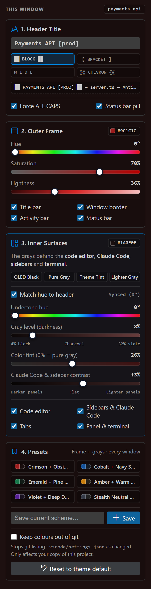

# Workspace Identity

**Give every IDE window its own colour and name, so you can tell them apart at a glance.**

If you keep several windows open at once (frontend, backend, a worker, production vs. staging), they normally all look identical. Workspace Identity lets you colour each window's frame and its inner "grays" and put a bold name in the title bar, all from one sidebar panel with live sliders.

Works in **Antigravity IDE** and **Visual Studio Code** (1.85 or newer).

## Features

- **Outer frame colour:** hue, saturation and lightness sliders recolour the title bar, window border, activity bar and status bar. Text colour switches between white and charcoal automatically, so it always stays readable.
- **Inner surfaces ("the grays"):** tint the backgrounds behind the code editor, Claude Code and the other sidebars, the tabs and the terminal. Go from OLED black to slate gray, with an optional subtle colour tint. There's also a contrast step between the editor and the side panels.
- **Quick grays:** one-click *OLED Black*, *Pure Gray*, *Theme Tint* and *Lighter Gray*.
- **Bold window title:** type a name and pick a style:
  - `██  PAYMENTS API  ██`
  - `【 PAYMENTS API 】`
  - `P A Y M E N T S`
  - `⟫⟫⟫  PAYMENTS API  ⟪⟪⟪`
- **Status bar pill:** shows the name at the far left of the status bar as well.
- **Presets in every window:** six built-in schemes, plus your own. A preset you save in one window appears in all the others.
- **Keep colours out of git** (optional): stops git listing `.vscode/settings.json` as changed. This only affects your copy of the project.
- **One-click reset:** puts the window back to your theme's defaults.

## How to use

1. Open the **Workspace Identity** icon in the activity bar.
2. Type a name for the window, and choose a title style.
3. Drag the **Outer Frame** sliders, or click a preset.
4. Adjust **Inner Surfaces** to tint the editor and panels.

Changes appear in the window as you drag. Each project folder remembers its own look.

The first time you open the panel, the sliders start at your current theme's colours. Nothing changes until you move one.

## What it changes

Everything is written to the project's **workspace settings** (`.vscode/settings.json`). Your global settings and theme are never modified.

| Setting | What Workspace Identity writes |
|---|---|
| `workbench.colorCustomizations` | Only its own colour keys. Any other colours you've set are left alone. |
| `window.title` and `window.titleSeparator` | Only when you type a name. Reset removes them again. |

**Reset to theme default** removes exactly those keys and nothing else.

## Good to know

- **Claude Code and the Explorer share one colour.** The secondary sidebar where Claude Code docks has no colour setting of its own, so both follow the *Sidebars & Claude Code* surface.
- **The title bar must be "custom"**, which is the default on Windows. If yours is set to `native`, the extension offers to switch it for you. That needs a restart.
- **The grays are designed for dark themes.** With a light theme the panel shows a warning, because dark backgrounds with dark text are hard to read. You can change the safe range in Settings.
- **Keep colours out of git** adds one line to `.git/info/exclude`, a private ignore list that is never committed. It can't hide a `.vscode/settings.json` that is *already* committed to the repository; the panel tells you if that's the case.

## Settings

| Setting | Default | Description |
|---|---|---|
| `workspaceIdentity.surfaceLightnessMin` | `4` | Darkest allowed lightness (%) for the inner surfaces. |
| `workspaceIdentity.surfaceLightnessMax` | `32` | Lightest allowed lightness (%) for the inner surfaces. |

## Commands

- **Workspace Identity: Apply Preset…** picks a colour scheme from the command palette.
- **Workspace Identity: Reset Workspace Colours** puts this window back to the theme default.

## Privacy

Workspace Identity makes no network requests and collects no data. Your presets are stored by the IDE, and they sync between your machines if Settings Sync is turned on.

## Licence

[MIT](LICENSE)
