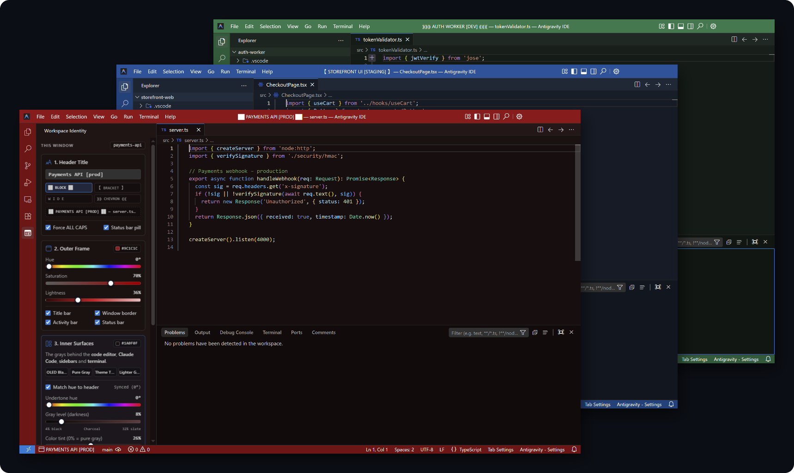
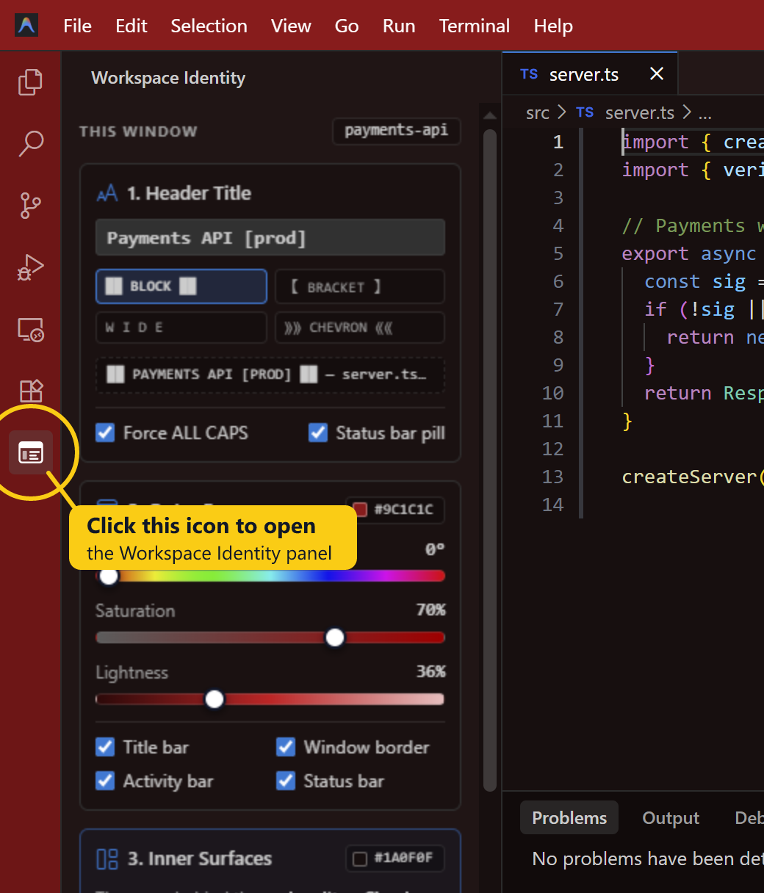
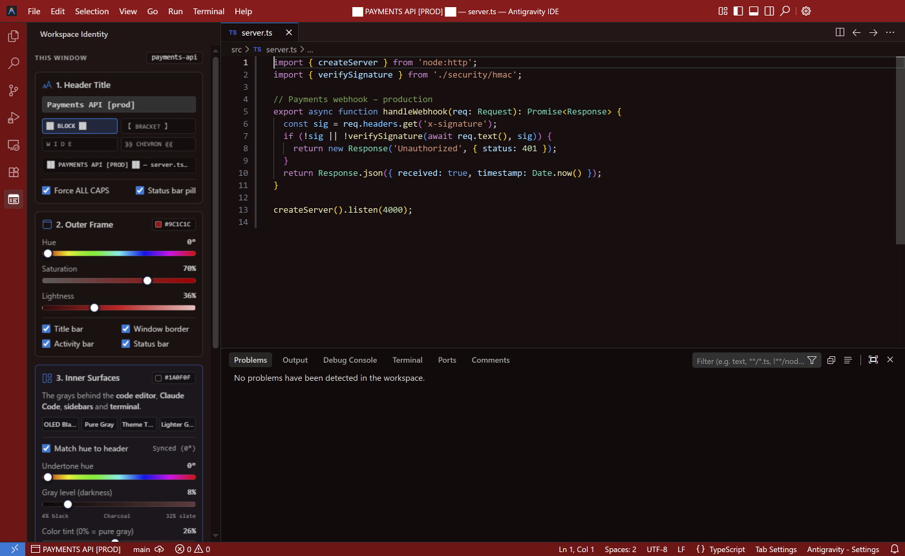

# Workspace Identity

**Tell your IDE windows apart at a glance.** Give each project its own frame colour, a tinted editor background and a bold name in the title bar.

## Why it exists

When several projects are open at once (a website, an API, a background worker, production and staging), every window looks identical, and it's easy to type into the wrong one. Workspace Identity colours each window's frame and backgrounds and puts a big name across the top, so you always know which project you're in.

Works in **Antigravity IDE** and **VS Code** (1.85 or newer).

## Getting started

1. **Open a project folder** (*File → Open Folder*). Each folder remembers its own look.
2. **Open the Workspace Identity panel** by clicking its icon in the bar of icons:

   

   - **Icons down the left edge** (VS Code, and Antigravity's default): click the window-shaped icon.
   - **Icons in a row across the top of the sidebar** (some Antigravity layouts): it's the **last icon in that row**. If the row is full, it may be hidden behind **⋯** or **»**.
   - **Or use the keyboard:** press `Ctrl+Shift+P` (`Cmd+Shift+P` on Mac), type **Workspace Identity**, and choose **Workspace Identity: Open Panel**.

   > Clicking *Workspace Identity* in the **Extensions** list only opens this information page. Use the icon or the command above to get the sliders.

3. **Click a preset**, or drag the sliders. The window changes as you drag.
4. **Type a name** in the first card (for example `PAYMENTS API [PROD]`) and pick a style.

To undo everything, click **Reset to theme default** at the bottom of the panel. Click it twice to confirm.

## The panel

| Card | What it does |
|---|---|
| **1. Header Title** | The name shown in the title bar, in one of four styles: `██ BLOCK ██`, `【 BRACKET 】`, `W I D E`, `⟫⟫ CHEVRON ⟪⟪`. It can also appear in the status bar. |
| **2. Outer Frame** | Colours the title bar, window border, activity bar and status bar. Text colour switches automatically to stay readable. |
| **3. Inner Surfaces** | The "grays" behind the editor, the sidebars (including Claude Code), the tabs and the terminal, from OLED black to slate, with an optional colour tint. |
| **4. Presets** | Six ready-made schemes plus your own. A preset saved in one window appears in every window. Also holds *Keep colours out of git* and *Reset*. |

## Good to know

- **Only this project is changed.** Colours are saved in the project's `.vscode/settings.json`. Only the keys this extension owns are touched, and *Reset* removes exactly those.
- **Claude Code and the Explorer share one colour.** The IDE has a single background setting for both sidebars.
- **The title bar must be "custom"**, which is the default on Windows. If yours is set to *native*, the extension offers to switch it for you. That needs a restart.
- **The grays are made for dark themes.** With a light theme you'll see a warning.
- **Keep colours out of git** stops git listing `.vscode/settings.json` as changed, on your computer only.
- **No network access and no tracking.** Saved presets travel between your computers if Settings Sync is on.

## Commands

| Command | |
|---|---|
| **Workspace Identity: Open Panel** | Opens the sliders panel |
| **Workspace Identity: Apply Preset…** | Applies a colour scheme without opening the panel |
| **Workspace Identity: Reset Workspace Colours** | Puts this window back to the theme default |

## Settings

| Setting | Default | |
|---|---|---|
| `workspaceIdentity.surfaceLightnessMin` | `4` | Darkest allowed background (%) for the inner surfaces |
| `workspaceIdentity.surfaceLightnessMax` | `32` | Lightest allowed background (%) for the inner surfaces |

## Licence

[MIT](LICENSE)
